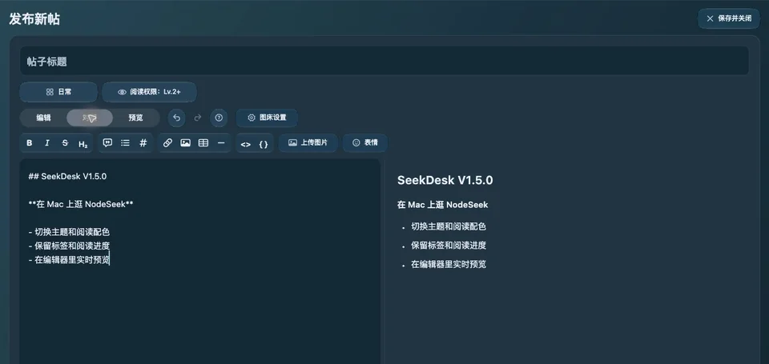
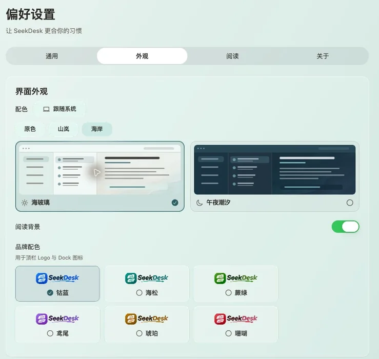

<p align="center">
  <picture>
    <source media="(prefers-color-scheme: dark)" srcset="assets/logo-dark.png">
    <source media="(prefers-color-scheme: light)" srcset="assets/logo-light.png">
    
  </picture>
</p>

<h1 align="center">SeekDesk</h1>

<p align="center"><strong>🖥️ 在 Mac 上，舒服地逛 NodeSeek。</strong></p>
<p align="center">多帖随手切换，讨论从容展开。把逛坛这件小事，做得顺手一点。</p>

<p align="center">
  
  
  
  
</p>

<p align="center">
  🌐 <a href="https://www.seekdesk.cc/">官网（建设中）</a> ·
  📦 <a href="https://github.com/cshaizhihao/SeekDesk/releases/latest">下载 V1.5.0</a> ·
  💬 <a href="https://github.com/cshaizhihao/SeekDesk/issues">反馈问题</a> ·
  🐔 <a href="https://www.nodeseek.com/">NodeSeek 社区</a>
</p>

## V1.5.0

SeekDesk 是面向 Mac 的第三方 NodeSeek 客户端。在侧栏找版块、在列表扫帖子、在右侧阅读。把多篇测评留在标签里，切回帖子时可以从上次读到的位置继续。

这一版使用 Flutter 重做桌面界面，由 Swift 负责论坛请求、登录和本机数据。Liquid Glass 贯穿搜索、阅读、编辑、设置和扩展中心。可选原色、山岚和海岸等主题，正文还有独立的阅读配色。

[更新日志](CHANGELOG.md) · [V1.5.0 发行说明](docs/releases/v1.5.0.md)

## 界面预览

| Markdown 对照预览 | 海岸主题与外观设置 |
| --- | --- |
|  |  |

## 功能

| 场景 | 可以做什么 |
| --- | --- |
| 浏览与搜索 | 最新帖子、最新回复、版块和热榜。搜索帖子或用户，可按版块筛选，也可直接打开 NodeSeek 主题链接。 |
| 分栏与标签 | 收起侧栏或帖子列表，横向滚动或拖动标签轨道，单独关闭标签，恢复最近关闭的帖子和阅读位置。 |
| 帖子阅读 | 跨页「只看楼主」，等级和身份徽标，楼层定位，图片查看与缩放，独立记忆 NQ 和 TQ 缩放。 |
| 写作和回复 | Markdown 工具栏、分栏预览、按账号保存草稿、选择发帖版块与阅读等级、图片拖放和动态表情。 |
| 外观 | 昼夜模式、主题、字号、品牌配色和阅读背景。 |
| 扩展中心 | 热榜、签到、老板键、剩余价值计算、屏蔽用户、关键词监控、管理记录查询和专用代理。 |
| 应用内更新 | 在「设置 → 关于」检查 GitHub 的新版本，发现新版后可直接下载、安装并重启。 |

专用代理可导入常见协议的节点链接和订阅，节点旁的闪电按钮可测延迟。代理开启后只应用于 SeekDesk 的论坛连接。

## 安装与升级

1. 在 [GitHub Releases](https://github.com/cshaizhihao/SeekDesk/releases/latest) 下载 `SeekDesk-1.5.0-macOS-arm64-unsigned.dmg`，适用于 macOS 14 或以上的 Apple Silicon Mac。
2. 打开 DMG，将 SeekDesk 拖入「应用程序」。如果 macOS 阻止首次启动，打开「系统设置 → 隐私与安全性」，根据系统提示操作。本发行包未进行 Apple Developer ID 签名或 Apple 公证。
3. **从 V1.0.0 升级时手动替换一次。** 后续在「设置 → 关于」点击「检查更新」。发现新版后点「更新并重启」。升级过程会保存可恢复的本地草稿；使用专用代理时，先关闭该代理再下载更新。

DMG 下载校验可在同一目录执行以下命令。

```sh
shasum -a 256 -c SeekDesk-1.5.0-macOS-arm64-unsigned.dmg.sha256
```

## 开发与构建

需要完整 Xcode 和 Flutter 3.50（Dart 3.14），构建目标为 Apple Silicon。将 SDK 放在 `.tools/flutter`，或用 `SEEKDESK_FLUTTER_SDK` 指定 SDK 绝对路径。

```sh
bash Flutter/scripts/flutter.sh pub get
bash Flutter/scripts/flutter.sh analyze
bash Flutter/scripts/flutter.sh test
bash Flutter/scripts/build-macos.sh debug
```

正式安装包使用 `bash Flutter/scripts/build-local-macos.sh` 准备 `dist/SeekDesk.app`。更新归档由 `bash Flutter/scripts/package-update.sh` 生成，Sparkle 更新签名私钥由发行者在本地保管。开发预览使用独立应用标识与本地存储。详见 [Flutter 工程说明](Flutter/README.md) 和 [macOS 构建说明](Flutter/macos/BUILDING.md)。

源码采用 [GPL-3.0-only](LICENSE)。感谢 Flutter、[liquid_glass_widgets](https://github.com/sdegenaar/liquid_glass_widgets)、[Sparkle](https://sparkle-project.org/)、[NodeSeek 热榜](https://greasyfork.org/scripts/560065) 和 [NS Seek](https://github.com/theslugger/ns-seek)。第三方许可见 [THIRD_PARTY_NOTICES.md](THIRD_PARTY_NOTICES.md)。

## 反馈

遇到问题时，可带上 SeekDesk 版本、macOS 版本、操作步骤和已遮盖隐私的截图提交 [GitHub Issue](https://github.com/cshaizhihao/SeekDesk/issues)。

SeekDesk 是独立开发的第三方客户端，与 NodeSeek 官方没有隶属关系。帖子内容、账号权限和社区规则均以 [NodeSeek](https://www.nodeseek.com/) 为准。

## 🤝 友情链接

感谢以下伙伴对本项目的支持，排名不分先后。

| 伙伴 | 简介 | 访问 |
| --- | --- | --- |
| <br>**Impart** | 全球自建家宽测速，VPS与IDC、银行卡、电话卡交流与优惠。 | [Telegram 群组](https://t.me/Impart_Cloud) |
| <br>**Shlii** | 高性价比的 VPS、NAT 平台 | [官网](https://shlii.io/) · [Telegram 群组](https://t.me/IncuShliidlb) |
| <br>**PickMyVPS** | 自购 400+ 台热门线路 / 落地机探针站 | [官网](https://www.pickmyvps.com/) · [Telegram 群组](https://t.me/PickMyVPS_Group) |
| <br>**CowCode** | 下一代AI全聚合中转平台 主流模型 0.1x 起 | [官网](https://cowcode.top/r/cshaizhihao) |

