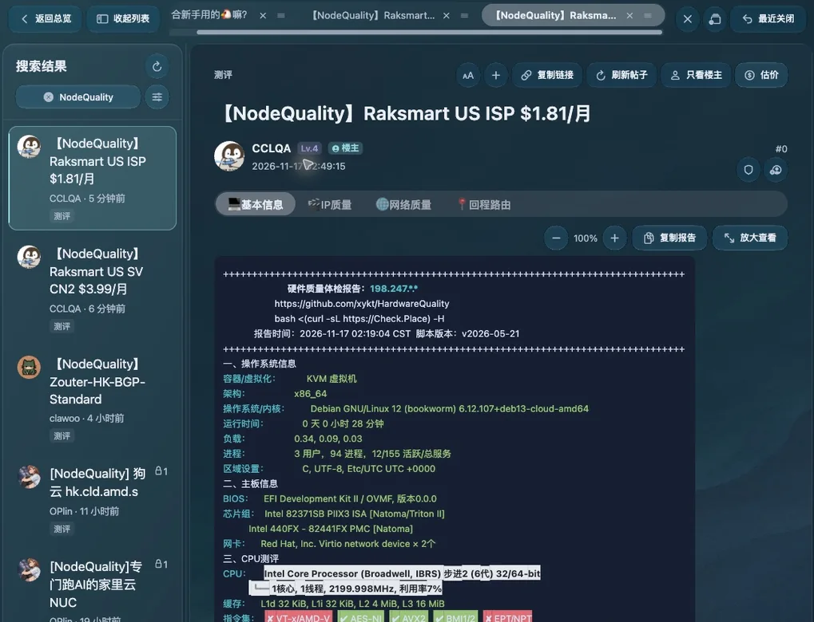
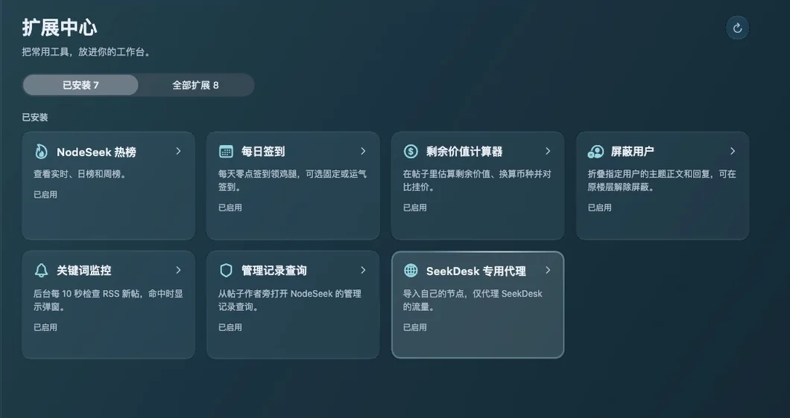
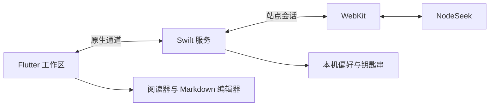
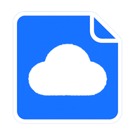

<p align="center">
  <picture>
    <source media="(prefers-color-scheme: dark)" srcset="assets/logo-dark.png">
    <source media="(prefers-color-scheme: light)" srcset="assets/logo-light.png">
    
  </picture>
</p>

<h1 align="center">SeekDesk</h1>

<p align="center"><strong>🖥️ 在 Mac 上，舒服地逛 NodeSeek。</strong></p>
<p align="center">多帖随手切换，讨论从容展开。把逛坛这件小事，做得顺手一点。</p>

<p align="center">
  
  
  
  
</p>

<p align="center">
  🌐 <a href="https://www.seekdesk.cc/">官网</a> ·
  📦 <a href="https://github.com/cshaizhihao/SeekDesk/releases/latest">下载安装</a> ·
  💬 <a href="https://github.com/cshaizhihao/SeekDesk/issues">反馈问题</a> ·
  🐔 <a href="https://www.nodeseek.com/">NodeSeek 社区</a>
</p>

<p align="center">
  <a href="#about">项目介绍</a> ·
  <a href="#screenshots">界面预览</a> ·
  <a href="#features">主要功能</a> ·
  <a href="#usage">安装与使用</a> ·
  <a href="#extensions">扩展中心</a><br>
  <a href="#comparison">网页版对比</a> ·
  <a href="#implementation">实现与数据</a> ·
  <a href="#faq">常见问题</a> ·
  <a href="#opensource">构建与贡献</a> ·
  <a href="#friends">友情链接</a>
</p>

<a id="about"></a>

## 认识 SeekDesk

**SeekDesk 是面向 macOS 的第三方 NodeSeek 客户端。** 左侧切换版块，中间浏览帖子，右侧读正文。可以同时打开多篇评测，比较线路和价格，切回原帖继续上次的阅读。写回帖时可并排看 Markdown 预览，热榜、剩余价值计算等工具也能在同一个窗口打开。

作者为 NodeSeek @cshaizhihao。SeekDesk 独立开发，与 NodeSeek 官方没有隶属关系。登录通过应用内的 NodeSeek 官方页面完成，帖子内容、账号权限和社区规则均以社区为准。[NodeSeek](https://www.nodeseek.com/) · [作者 GitHub](https://github.com/cshaizhihao)

<a id="screenshots"></a>

## 界面预览

### 多栏阅读



<details>
<summary>查看 Markdown 编辑器、主题和扩展中心</summary>

### Markdown 编辑器


### 外观设置


### 扩展中心



</details>

<a id="features"></a>

## 主要功能

### 浏览与阅读

- **版块和搜索**支持最新帖子、最新回复、版块筛选和精品区。可搜索帖子或用户、选择多个版块、查看最近搜索，也可粘贴 NodeSeek 帖子链接直达。历史搜索受站点登录状态和权限限制。
- **多栏和多标签**支持收起帖子列表、调节侧栏宽度、后台打开、拖动排序、横向滚动、单独关闭和恢复最近关闭的标签。回到已读帖子时可继续上次的阅读位置。
- **楼层和媒体**支持按楼层定位、放大图片、展开表格与代码。作者栏区分等级和社区身份。「只看楼主」可汇总各页楼主的回复，相关楼层可跳回原位置。
- **测评报告**分别记忆 NQ 和 TQ 缩放比例。NQ 长报告以阅读宽度为基准等比展开，ANSI 终端报告可以查看和复制原文。

### 写作与互动

- **Markdown 编辑器**用于发帖、回复和私信，支持编辑、对照、预览三种视图。新帖可选择版块和阅读等级。
- **图片与表情**支持选图、拖放、剪贴板图片、图片链接及动态表情。本机导入的表情可以分组，普通图片支持发送尺寸调整。
- **草稿、通知和个人空间**按账号保存本机草稿，可查看 @我、主题回复、私信、个人主题和评论。互动与编辑取决于 NodeSeek 的账号权限。

### 外观与阅读设置

- 原色、山岚、海岸三套主题，支持白天、黑夜和跟随系统，以及独立的阅读背景和品牌图标配色。
- 可分别调整列表、正文、作者栏、侧栏版块和热榜字号。从设置或扩展中心返回时可以继续阅读原帖。

<a id="usage"></a>

## 安装与使用

### 安装和更新

1. 从 GitHub Releases 下载文件名以 `-macOS-arm64-unsigned.dmg` 结尾的安装包。适用于 **Apple Silicon Mac**，最低系统要求为 **macOS 14**。[下载正式版](https://github.com/cshaizhihao/SeekDesk/releases/latest)
2. 打开 DMG，把 SeekDesk 拖到「应用程序」，再从「应用程序」启动。发行包未进行 Apple Developer ID 签名或 Apple 公证。如果系统阻止首次打开，确认下载来源后按「系统设置 → 隐私与安全性」的提示处理。
3. **V1.0.0 用户手动替换一次。** 自 V1.5.0 起，打开「设置 → 关于」检查更新，再点「更新并重启」。使用 SeekDesk 专用代理时，先关闭该代理再下载更新。

当前发行包为 V1.5.1。将 DMG 与对应的 `.sha256` 文件放在同一目录，可执行下方命令校验。版本改动集中记录在发行页。[V1.5.1 发行说明](docs/releases/v1.5.1.md) · [完整更新日志](CHANGELOG.md)

```sh
shasum -a 256 -c SeekDesk-1.5.1-macOS-arm64-unsigned.dmg.sha256
```

### 第一次使用

1. 从「最新帖子」或「论坛版块」进入帖子。用「返回总览」回到列表，或收起列表专心阅读。
2. 点击右上角账号按钮，打开 NodeSeek 官方登录页。登录后可在账号权限范围内浏览和互动。
3. 点「发布新帖」选择版块、阅读权限，或进入帖子后使用「写回复」和楼层引用。需要上传图片时，在编辑器的图床设置里填写个人 NodeImage 密钥。[NodeImage](https://www.nodeimage.com/)
4. 在「设置 → 阅读」调整字号、作者栏和测评缩放，在「设置 → 外观」切换主题和图标配色。
5. 在「扩展中心」启用需要的工具。关键词监控和自动签到依赖应用在运行。

### 常用快捷键

| 操作 | 快捷键 |
| --- | --- |
| 搜索或打开 NodeSeek 帖子链接 | `⌘ K` |
| 刷新当前帖子或帖子列表 | `⌘ R` |
| 列表中选择上一帖／下一帖 | `↑`／`↓` |
| 打开选中的帖子 | `Return` |
| 在后台打开帖子 | `⌘ Return` 或 `⌘ 点击` |
| 关闭当前帖子标签 | `⌘ W` |
| 恢复最近关闭的标签 | `⌘ ⇧ T` |
| 切换到下一个／上一个标签 | `⌃ Tab`／`⌃ ⇧ Tab` |
| 返回论坛或关闭当前面板 | `Esc`，视焦点和页面而定 |
| 打开设置 | `⌘ ,` |

<a id="extensions"></a>

## 扩展中心

| 扩展 | 用途 |
| --- | --- |
| NodeSeek 热榜 | 切换实时、日榜和周榜，在侧栏看前十名，或进入完整榜单。 |
| 每日签到 | 支持固定或运气签到，也可按北京时间设置自动签到。 |
| 摸鱼老板键 | 用快捷键将论坛窗口切换为工作表外观。 |
| 剩余价值计算器 | 按续费周期与剩余时间估价，可换算币种并对比挂牌价。 |
| 屏蔽用户 | 折叠指定用户的主题正文和回复，保留原楼层位置。 |
| 只看楼主 | 在当前主题汇总楼主正文和跨页回复。 |
| 关键词监控 | 按规则匹配公开 RSS 新帖，可选择开启系统通知。 |
| 管理记录查询 | 从帖子作者旁查询 NS Seek 上的公开记录。 |
| SeekDesk 专用代理 | 导入节点或订阅，选择节点后手动开启。闪电按钮可以检测节点延迟，其他应用仍使用各自的网络设置。 |

关键词监控支持用逗号分隔规则组，用 `+` 连接同组必含词。例如 `香港+VPS, 日本+软银, 优惠` 匹配任一组。专用代理支持 VLESS、VMess、Shadowsocks、Trojan、Hysteria2 等协议，具体参数见使用说明。[专用代理说明](docs/PROXY.md)

<a id="comparison"></a>

## 和 NodeSeek 网页版有什么区别？

| 场景 | SeekDesk | NodeSeek 网页版 |
| --- | --- | --- |
| 使用环境 | Apple Silicon Mac 桌面应用 | 支持现代浏览器的设备 |
| 阅读和切换 | 分栏、独立帖子标签、阅读进度和测评缩放 | 使用站点页面和浏览器标签 |
| 发帖和回复 | 集成 Markdown 工具栏、对照预览与本机草稿 | 使用站点编辑器 |
| 常用工具 | 热榜、签到、关键词监控、估价等内置扩展 | 站点功能与浏览器扩展 |
| 登录和权限 | 通过官方登录页建立应用内会话 | 通过浏览器在站点登录 |

<a id="implementation"></a>

## 实现与本机数据

Flutter 和 Impeller 负责工作区与内容界面，Liquid Glass 由 `liquid_glass_widgets` 渲染。Swift 与 AppKit 提供 macOS 窗口和系统集成，WebKit 管理 NodeSeek 登录与站点交互，Swift 解析论坛返回的列表、楼层与内容块供 Flutter 渲染。



| 数据 | 存储或处理方式 |
| --- | --- |
| 登录会话 | SeekDesk 自己的 WebKit 网站数据存储。 |
| 主题、字号、搜索历史和扩展偏好 | 保存在本机偏好设置。 |
| 新帖、回复、私信草稿与阅读状态 | 按账号保存或隔离，方便回到原草稿和阅读位置。 |
| 图片和近期帖子 | 使用有容量限制的本机缓存。 |
| NodeImage 密钥、代理凭据与订阅地址 | 存在 macOS 钥匙串，相关操作按需读取。 |
| 应用内更新 | 从 GitHub Releases 读取正式版本，Sparkle 校验签名后安装。 |

源码包含界面、系统桥接、共享 Swift 服务、测试和构建脚本。各目录及调用方式见工程说明。[Flutter 工程](Flutter/README.md) · [原生桥接约定](Flutter/lib/core/native_contract.md)

<a id="faq"></a>

## 常见问题

<details>
<summary>浏览器已登录，为什么客户端还要登录？</summary>

SeekDesk 使用独立的 WebKit 会话。首次使用或会话失效时，从客户端打开 NodeSeek 官方页面重新登录。

</details>

<details>
<summary>使用客户端一定要配置 NodeImage 吗？</summary>

需要通过客户端上传本地图片、使用需上传的本机表情或发送缩放后的图片副本时，才需要 NodeImage 密钥。浏览、文字编辑和使用已有图片网址可以直接进行。

</details>

<details>
<summary>电脑休眠或退出客户端后，自动签到和关键词提醒会继续吗？</summary>

两项功能依赖 SeekDesk 进程。应用退出时任务停止，休眠、断网及站点验证也可能延迟执行。

</details>

<details>
<summary>可以导入浏览器脚本、跨设备同步或完全离线浏览吗？</summary>

扩展中心提供应用内置工具。浏览器用户脚本、跨设备同步和完整离线浏览暂未提供。

</details>

<details>
<summary>有 Intel Mac、Windows 或 Linux 安装包吗？</summary>

发行版面向 macOS 14 或以上的 Apple Silicon Mac。

</details>

<a id="opensource"></a>

## 开源、构建与贡献

源码采用 **GPL-3.0-only**。合作伙伴标志及截图中的论坛内容归相应权利人所有。[项目许可证](LICENSE) · [第三方声明](THIRD_PARTY_NOTICES.md)

在 Apple Silicon Mac 上安装完整 Xcode 和 Flutter 3.50（Dart 3.14）。Flutter SDK 可放在仓库的 `.tools/flutter`，也可通过环境变量 `SEEKDESK_FLUTTER_SDK` 指定绝对路径。

```sh
git clone https://github.com/cshaizhihao/SeekDesk.git
cd SeekDesk
bash Flutter/scripts/flutter.sh pub get
bash Flutter/scripts/flutter.sh analyze
bash Flutter/scripts/flutter.sh test
bash Flutter/scripts/build-macos.sh debug
```

共享 Swift 服务的回归检查可执行 `bash scripts/test.sh` 和 `bash scripts/test-regressions.sh`。正式交付使用 Flutter 的 Release 构建入口。[macOS 构建说明](Flutter/macos/BUILDING.md) · [发行说明](docs/RELEASING.md)

欢迎提交问题和改进。报告问题时可附 macOS 版本、SeekDesk 版本、操作步骤与适当遮盖后的截图。[提交 Issue](https://github.com/cshaizhihao/SeekDesk/issues) · [提交 Pull Request](https://github.com/cshaizhihao/SeekDesk/pulls)

## 致谢

- 感谢 NodeSeek 社区提供论坛内容，以及 @小号 提供社区热榜服务。[NodeSeek 热榜项目](https://greasyfork.org/scripts/560065)
- 感谢 @slugger 的管理记录脚本与 NS Seek 后端，以及 @sss1231 的北京时间修正说明。[原脚本](https://greasyfork.org/scripts/567915) · [NS Seek](https://github.com/theslugger/ns-seek) · [时间修正说明](https://www.nodeseek.com/post-870735-1)
- 感谢 Flutter、Liquid Glass 组件和 Sparkle 项目的维护者。[Flutter](https://flutter.dev/) · [liquid_glass_widgets](https://github.com/sdegenaar/liquid_glass_widgets) · [Sparkle](https://sparkle-project.org/)

<a id="friends"></a>

## 🤝 友情链接

感谢以下伙伴对本项目的支持，排名不分先后。

| 伙伴 | 简介 | 访问 |
| --- | --- | --- |
| <br>**Impart** | 全球自建家宽测速，VPS与IDC、银行卡、电话卡交流与优惠。 | [Telegram 群组](https://t.me/Impart_Cloud) |
| <br>**Shlii** | 高性价比的 VPS、NAT 平台 | [官网](https://shlii.io/) · [Telegram 群组](https://t.me/IncuShliidlb) |
| <br>**PickMyVPS** | 自购 400+ 台热门线路 / 落地机探针站 | [官网](https://www.pickmyvps.com/) · [Telegram 群组](https://t.me/PickMyVPS_Group) |
| <br>**CowCode** | 下一代AI全聚合中转平台 主流模型 0.1x 起 | [官网](https://cowcode.top/r/cshaizhihao) |
| <br>**VPStarter** | VPS 详细观察与评测的工具站 | [官网](https://vpstarter.com/) |
| <br>**deerstack** | 服务器实测、避坑教程和实用工具 | [官网](https://deerstack.com/) |
